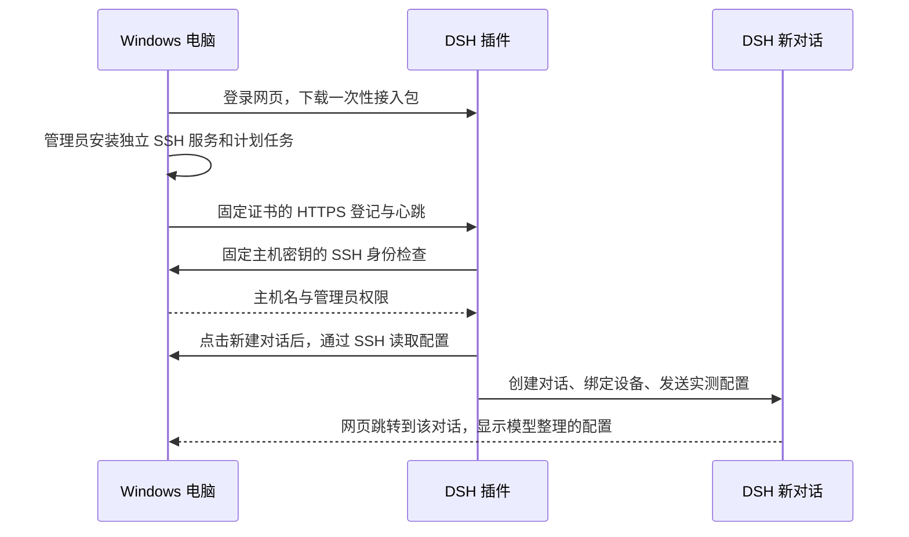

# DSH Windows Devices

让运行在移动 WiFi / Linux 主机上的 **DSH，通过真实 SSH 管理接入该 WiFi 的 Windows 电脑**。

Windows 电脑首次从 DSH 网页下载接入程序，以管理员身份运行一次。之后由计划任务检查目标 WiFi、向 DSH 更新设备状态，并按授权状态启停 SSH。DSH 的“Windows 设备”页面提供设备管理和一键新建对话。

当前版本：**0.2.0**。这是 **DSH 插件**，不是浏览器扩展，也不是 Codex 插件。

## 功能

| 功能 | 说明 |
| --- | --- |
| 一次接入 | 下载 `.bat` 接入包，允许 Windows 管理员提权，完成 OpenSSH、密钥、防火墙及计划任务配置 |
| 自动发现在线设备 | 开机、网络变化及每分钟检查目标 WiFi，并更新设备地址与状态 |
| SSH 在线核验 | 通过 SSH 实际执行身份检查，确认主机名、用户与管理员权限 |
| 自定义设备名称 | 在网页中修改显示名称，支持中文；不修改 Windows 主机名、登录用户名或 SSH 密钥 |
| 对话绑定设备 | 为每个 DSH 对话选择一台电脑，后续 `windows_*` 工具默认使用该设备 |
| 新建对话 · 核验 SSH | 先通过 SSH 读取配置，再创建绑定该设备的新对话；自动发送首条配置消息，并由模型整理回复 |
| 远程 PowerShell | 在指定 Windows 设备上执行命令，返回标准输出、错误输出及退出码 |
| 文件操作 | 列目录、读取 UTF-8 文本、写入文本；写入默认不覆盖已有文件 |
| 停用、恢复、解绑 | 网页管理授权；Windows 开始菜单另有本地停用、恢复、卸载接入入口 |

新对话的首条消息包含实测的系统版本、CPU、内存、磁盘容量与剩余空间、SSH 地址、检查时间及管理员权限状态。SSH 读取失败或主机身份不符时会报错，不会把失败标记为核验成功。重复点击同一请求不会重复创建对话。

## 使用流程

### 新电脑首次接入

1. 将 Windows 电脑连接到目标移动 WiFi。
2. 在该电脑打开 DSH 网页并登录。
3. 进入 **设置 → Windows 设备 → 添加本机 · 下载接入程序**。
4. 双击下载的 `.bat`，在管理员提示中选择“是”。浏览器不会自动执行本地安装程序。
5. 等待显示接入完成，回到设备页面，等待 **在线 · SSH 已验证**。
6. 点击 **新建对话 · 核验 SSH**，或先打开已有对话，再点击 **用于当前对话**。

接入包仅供一台设备使用，30 分钟内有效；DSH 重启也会使尚未使用的接入包失效。过期后请重新下载。

### 日常使用

- **修改名称**：编辑后保存，名称会持久保存；允许 1–64 个字符，不接受空名称、换行或控制字符。
- **新建对话 · 核验 SSH**：按钮仅在设备已通过在线核验时可用；新对话标题包含设备显示名称。
- **用于当前对话**：切换当前对话的目标电脑。
- **停用 / 恢复**：控制 DSH 是否可以继续使用该设备。
- **解除绑定**：立即撤销 DSH 持有的设备 SSH 私钥；Windows 下次联系主机时清理对应授权。离线时会显示等待清理。

示例指令：

> 查看这台 Windows 电脑的系统信息和磁盘空间。

> 列出 C:\Users\Public\Documents 中的文件。

> 在 C:\Users\Public\Documents 中新建一个 hello.txt，内容为“你好”。

## 环境与网络要求

当前实现针对固定移动 WiFi 网段，**不是任意局域网的通用自动配置工具**：

| 项目 | 当前约定 |
| --- | --- |
| WiFi 网关 / DSH 宿主地址 | `192.168.0.1` |
| Windows 地址范围 | `192.168.0.*`，通过物理 WiFi 网卡接入 |
| DSH 网页 | 部署环境使用 `http://192.168.0.1:8117/`；认证由现有 DSH / 反向代理提供 |
| 设备登记服务 | DSH 插件监听 `https://192.168.0.1:8118` |
| Windows SSH | 独立服务 `DshWindowsSSH`，端口 `2222` |
| 防火墙 | 该规则只允许网关地址通过当前 WiFi 接口访问 Windows 的 `2222` 端口 |
| DSH 宿主 | Node.js 22 或以上，兼容本插件所使用的 Cordis、ModuleLoader、Session Controller 接口 |
| Windows | Windows PowerShell 5.1、本地管理员账户，以及可用的 OpenSSH Server |

安装器优先复用正在运行的 `sshd` 服务所使用的程序；否则使用 Windows 系统 OpenSSH，缺失时尝试安装 Windows 可选功能。安装可选功能可能需要联网。原有 `sshd` 服务及其端口 22 配置不由本插件改写。

若使用其他网段，需要同时调整 `lib/core.js` 中的默认地址/地址检查及 `scripts/maintain.ps1` 中的 WiFi 匹配逻辑。尚未提供网页配置项。

## 安装到 DSH

本仓库提供源码和本地打包安装方式，尚未发布到 npm 或 DSH 插件市场。

在已安装 Node.js 和 npm 的电脑上进入源码目录：

```sh
git clone https://github.com/wx13489646836/dsh-windows-devices.git
cd dsh-windows-devices
npm ci --ignore-scripts
npm test
npm pack
```

将生成的 `dsh-windows-devices-0.2.0.tgz` 上传到 **实际运行 DSH 的环境内部**，然后执行：

```sh
dsh plugin --profile web add ./dsh-windows-devices-0.2.0.tgz
```

随后按自己的部署方式重启 DSH 网页进程并刷新浏览器。使用其他 profile 时替换 `web`。如果 DSH 位于 Android 的 Alpine chroot 内，安装命令应在该 chroot 内执行。

打包产物包含运行依赖，方便上传到移动 WiFi。`--ignore-scripts` 跳过可选原生加速构建；SSH 使用 JavaScript 实现。安装成功后应在设置中看到“Windows 设备”。

## 工作原理



### 提供给 DSH 的工具

| 工具 | 用途 |
| --- | --- |
| `windows_devices` | 查看设备及当前对话的选择 |
| `windows_exec` | 执行目标 Windows 上的 PowerShell 脚本 |
| `windows_list_files` | 列出目录 |
| `windows_read_file` | 读取不超过 1 MiB 的 UTF-8 文本 |
| `windows_write_file` | 写入 UTF-8 文本，默认拒绝覆盖 |

文件工具目前使用 SSH 执行 PowerShell，**尚未切换到 SFTP 文件传输实现**。写入接口的文本上限为 40 KB，但 Windows 命令行长度还会进一步限制实际可写大小，因此适合小文本文件，不适合大文件传输。

命令输出限制为 1 MiB；执行超时或断线后不会自动重放命令。远端进程可能仍在运行，应先检查状态再决定是否重试。

## 授权与数据存储

- 接入账户提供管理员级 SSH 命令执行能力。能够使用 DSH 及其设备工具的人可能获得相应的 Windows 控制能力；应配置好 DSH 的登录认证，并只在信任的局域网分发接入程序。
- Windows SSH 仅接受公钥认证。每台设备使用独立密钥，Windows 保存公钥，DSH 保存相应私钥。
- 设备 HTTPS 登记与心跳校验接入包中的固定证书指纹；DSH 连接 SSH 时校验设备主机密钥指纹。
- DSH 端状态位于 `~/.dsh/windows-devices/`。其中 `devices.json`、`tls.json` 含敏感凭据，不能公开提交。
- Windows 状态、主机密钥及日志位于 `%ProgramData%\DshWindowsDevices`。私钥权限限定为 SYSTEM 与 Administrators。
- 默认计划任务名称为 `DshWindowsDevices-Check` 和 `DshWindowsDevices-Network`。
- 本地卸载撤销服务、授权密钥、计划任务及插件防火墙规则；可能保留状态文件和日志供排错。它不是全目录清理工具。

## 排错

| 现象 | 检查方式 |
| --- | --- |
| 接入包失效 | 回设备页重新下载，在有效期内运行 |
| OpenSSH 可选功能安装失败 | 在 Windows 中完成 OpenSSH Server 安装后重试 |
| 服务无法启动 | 阅读接入窗口中的 SSH 启动日志，以及 `%ProgramData%\DshWindowsDevices\sshd.log` |
| 主机私钥权限过宽 | 使用本版安装器重试；它会重建密钥访问权限表，清除残留显式权限并核验所有者 |
| 设备离线 | 检查是否连接目标物理 WiFi、网关与 IP 是否匹配，以及 `maintenance.log` |
| 新建对话失败 | 先测试 SSH；随后检查 DSH 默认模型、预设和 Session Controller 是否可用 |
| 更新后按钮未出现 | 重启 DSH 网页进程并强制刷新浏览器 |

## 验证范围与限制

- 已在移动 WiFi 上的 DSH 与 Windows 11 设备之间完成真实 SSH、管理员权限与配置读取测试。
- 已实测设备重命名保存、新对话创建与绑定、首条配置消息，以及模型的完整回复。
- 新对话的原生导航调用有单元测试；自动化浏览器受到客户端拦截，尚未完成按钮跳转的实际浏览器点击验收。
- 自动接入计划任务已验证安装；未把 Windows 重启、WiFi 反复断连恢复或所有 Windows / DSH 版本的兼容性宣称为已验证。
- 当前不提供公网穿透、Tailscale 接入或远程桌面画面控制。

## 源码结构

```text
lib/core.js          设备、密钥、心跳、SSH 执行与授权管理
lib/conversation.js  SSH 配置读取及新对话创建、绑定、首条消息
lib/index.js         DSH 宿主插件、HTTP 接口、接入包生成、工具注册
lib/client.js        DSH 设置页中的设备列表与操作
scripts/setup.ps1    Windows 首次安装与失败重试
scripts/maintain.ps1 网络检测、心跳、停用、恢复和卸载
test/               SSH、重命名、新对话及导航调用测试
cordis.patch.yml    DSH 插件启用声明
```

## 许可证

本项目使用 [MIT License](LICENSE)。依赖仍遵循各自许可证。
